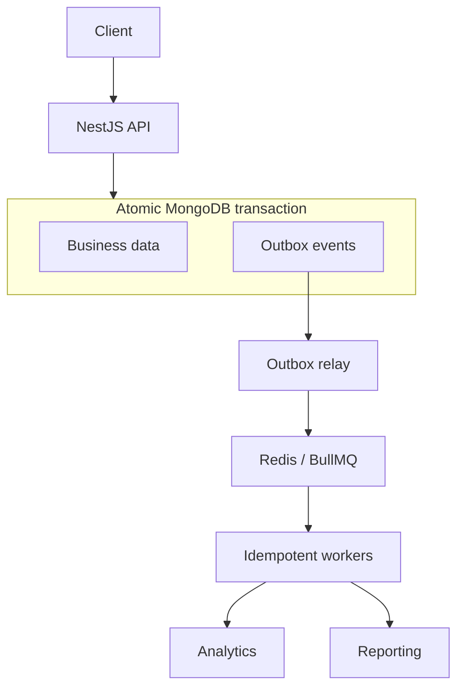

# Luis Bauza

**Full Stack Developer · Backend Engineering & Software Architecture**

*Beyond the interface. Into the architecture.*

[Portfolio](https://lebauzagit.netlify.app) · [LinkedIn](https://www.linkedin.com/in/lebauzagit/)

## About

My frontend background gives me an end-to-end perspective on software development. I work with JavaScript and TypeScript across client applications, APIs, data persistence and asynchronous processing, with additional experience in C# and PHP. I value maintainability, reliability and understanding the problem before choosing a solution.

## Technology ecosystem

- **Core stack:** JavaScript · TypeScript · Node.js · NestJS · MongoDB · Redis · Vue.js · Nuxt
- **Data & asynchronous systems:** Mongoose · PostgreSQL · Prisma · TypeORM · BullMQ
- **Frontend & experience:** Astro · Nuxt UI · Tailwind CSS · Pinia · TanStack Query
- **API & security:** REST APIs · OpenAPI / Swagger · Passport.js · JWT
- **Additional languages:** C# · PHP
- **Developer automation:** Git · GitHub Actions · Docker · Linux · PowerShell · pnpm · Playwright · Figma REST API · Nuxt Content · pdfmake · Codex · MCP
- **Currently exploring:** Flutter · Dart · Distributed systems · Software architecture

## Engineering mindset

Understand first. Build second. Improve continuously.

## Conceptual architecture

Conceptual example, not a claim of a deployed system.
